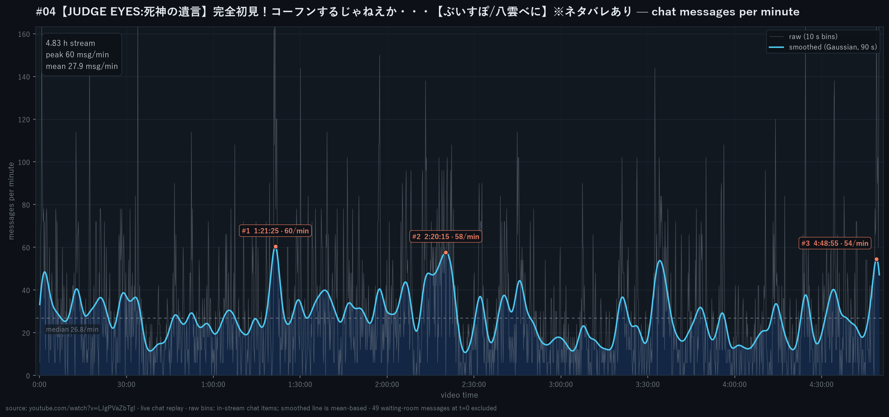

# auto_clipper

**Experiment: can we graph a YouTube chat's speed over time from a video whose chat replay actually exists?**

**Yes.** Here is the chat rate of
[`LJgPVaZbTgI`](https://youtu.be/LJgPVaZbTgI) (八雲べに, 2026-11-14, 4 h 49 min)
reconstructed from its live-chat replay:



The grey spikes are raw counts in 10-second bins; the blue line is a 90-second
Gaussian smoothing. No transcript, video download, or YouTube Data API key was
needed — just the `live_chat` subtitle track and its video offsets.

## What the data says

- **8,153** chat items in the replay; **49** waiting-room messages were
  collapsed onto `t=0` and excluded, leaving **8,104** in-stream items.
- Average **27.9 messages/min**, median smoothed rate **26.8/min**.
- The stream is not uniformly chatty: quiet stretches sit near 10/min while
  reaction bursts reach **50–60/min** for a sustained minute.

| # | Time | Smoothed rate | Messages in ±5 min | What chat was reacting to (spot check) |
|---|------|---------------|--------------------|----------------------------------------|
| 1 | 1:21:25 | 60.3/min | 374 | A wave of agreement about "ひなーの派" |
| 2 | 2:20:15 | 57.6/min | 482 | The "final last" ending joke |
| 3 | 4:48:55 | 54.5/min | 281 | Goodbyes as the stream wraps up |
| 4 | 3:34:05 | 53.8/min | 367 | A QTE / "ガキィ！" moment |
| 5 | 0:01:45 | 48.5/min | 301 | Opening greetings |

The spot checks are informal: I read the messages in a ±20 s window around each
peak. They are enough to show the peaks are real content reactions, not just
noise from the replay parser.

## Method

1. **Fetch** — `yt-dlp --write-subs --sub-langs live_chat --sub-format json`
   downloads the replay as JSON Lines. Each line is a replay batch with a
   `replayChatItemAction.videoOffsetTimeMsec`.
2. **Parse** — keep text, superchat, sticker, and membership renderers; skip
   viewer-engagement banners; de-duplicate by renderer id.
3. **Drop waiting-room chat** — YouTube collapses pre-stream messages onto
   offset 0 but keeps their wall-clock `timestampUsec`. 49 messages at `t≈0`
   spanning 34 minutes of wall clock are waiting-room chat, not a 190/min burst
   at the start of the video.
4. **Bin and smooth** — count messages in 10 s bins, convert to messages/min,
   then convolve with a Gaussian kernel (σ = 90 s). Zero padding outside the
   stream keeps the ends from growing fake plateaus; the curve tapers there.
5. **Export** — PNG chart, full 10 s series, peak table, and a JSON summary.

Why smoothing at all? A live chat is a point process: per-second counts are
almost all zeros with occasional spikes. Binning to 10 s makes the spikes
visible; smoothing makes the trend readable without hiding the raw signal.

## Reproduce

Requirements: Python ≥ 3.11, [`yt-dlp`](https://github.com/yt-dlp/yt-dlp) on
`PATH`, and network access to YouTube.

```powershell
python -m venv .venv
.venv\Scripts\Activate.ps1
pip install -e ".[dev]"
pip install yt-dlp

python -m autoclipper fetch   https://youtu.be/LJgPVaZbTgI
python -m autoclipper analyze https://youtu.be/LJgPVaZbTgI
python -m pytest
```

If you do not install the package, prefix commands with `$env:PYTHONPATH="src"`
(PowerShell) and run `python -m autoclipper ...` from the repository root.

Useful options:

```text
--bin-s 10              raw bin width in seconds
--sigma-s 90            Gaussian smoothing sigma in seconds
--min-separation-s 600  minimum distance between reported peaks
--top 5                 number of peaks to keep
--keep-preroll          do not drop waiting-room messages at t=0
```

A Dev Container is included for a clean environment:

```powershell
# VS Code: "Dev Containers: Reopen in Container"
# or: docker build -f .devcontainer/Dockerfile -t auto-clipper . && docker run --rm -it -v ${PWD}:/workspace auto-clipper
```

## Outputs

| File | Contents |
|------|----------|
| `out/chat_rate.png` | chart shown above |
| `out/chat_rate.csv` | 10 s bins: raw count, raw/min, smoothed/min |
| `out/peaks.csv` | top peaks with messages in a ±5 min window |
| `out/summary.json` | video metadata, counts, rates, peak moments |

Raw replays land in `data/` and are git-ignored (13 MB for this stream).

## Caveats

- **A replay must exist.** Videos with chat disabled, cleared chat, or no
  archive simply have no `live_chat` track; `yt-dlp` will report that.
- **Replays are not complete archives.** Deleted, held-for-review, or filtered
  messages are absent, and very large streams can have gaps.
- **Offsets are video time**, not wall-clock time. The waiting-room collapse is
  detected heuristically (near-zero offset plus a wall-clock span ≥ 60 s); it
  can be disabled with `--keep-preroll`.
- **Edge tapering.** Zero padding means the first and last minutes are smoothed
  with less context. Treat boundary values as lower bounds.
- **Counts ≠ people.** One excited viewer can post many messages, and bots or
  spam are included. Use unique authors for an audience-size proxy.
- This is a research tool. Respect YouTube's Terms of Service and do not hammer
  the service with repeated downloads.

## Next steps

The experiment proves the data source; the analytics can now be built on top:

- burst detection from chat alone (repeated tokens, emoji walls, superchats);
- correlate chat spikes with audio loudness or scene cuts to find highlight
  moments for clipping;
- unique chatters, message length, and emote distributions per window;
- compare many streams to learn channel-specific baselines;
- serve the series to a web dashboard instead of a static PNG.

## Layout

```text
src/autoclipper/
  live_chat.py   fetch + parse live-chat JSONL, waiting-room split
  rate.py        10 s bins, Gaussian smoothing, peak picking
  plot.py        dark-theme matplotlib chart
  cli.py         `fetch` / `analyze` commands
tests/           parser, binning, smoothing and peak tests
out/             committed example outputs
data/            raw downloads (git-ignored)
```
