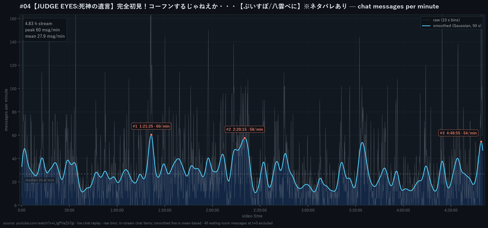
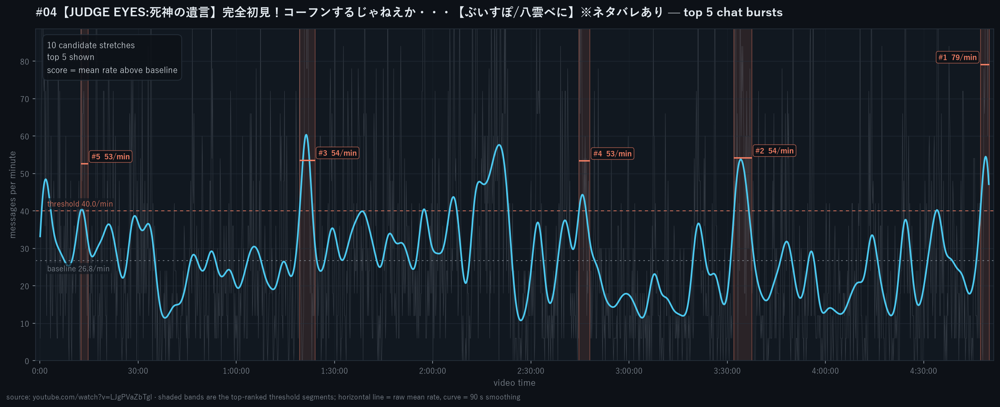

## The sample

This is the chat rate of
[`LJgPVaZbTgI`](https://youtu.be/LJgPVaZbTgI) (八雲べに, 14 November 2026),
reconstructed from the public live-chat replay. Grey is the raw 10-second
signal; blue is a 90-second Gaussian smoothing.

{width=100%}

```{python}
#| label: overview
from pathlib import Path
import json

import pandas as pd
from IPython.display import Markdown, display

out_dir = next(
    path for path in (Path("../out"), Path("out"))
    if (path / "summary.json").exists()
)
summary = json.loads((out_dir / "summary.json").read_text(encoding="utf-8"))
segments_payload = json.loads((out_dir / "segments.json").read_text(encoding="utf-8"))

display(Markdown(f"""
**{summary['video']['title']}**

- Stream length: **{summary['duration_hms']}**
- Chat items: **{summary['chat_items']:,}** total; **{summary['chat_items_analyzed']:,}** in-stream after removing **{summary['preroll_messages_excluded']}** waiting-room messages
- Mean rate: **{summary['mean_per_min']:.1f}** messages/min; median smoothed rate **{summary['median_smoothed_per_min']:.1f}**/min
- Segment threshold: **{segments_payload['threshold_per_min']:.1f}**/min (baseline **{segments_payload['baseline_per_min']:.1f}**/min)
- Candidate stretches above threshold: **{segments_payload['candidates']}**
"""))
```

## Fastest chat segments

The segmentation baseline finds stretches above a robust threshold, merges
short gaps, removes blips, and ranks the rest by mean chat rate above the
stream baseline. The five strongest are:

```{python}
#| label: tbl-segments
def hms(seconds: float) -> str:
    total = max(0, int(round(seconds)))
    hours, remainder = divmod(total, 3600)
    minutes, secs = divmod(remainder, 60)
    return f"{hours}:{minutes:02d}:{secs:02d}" if hours else f"{minutes}:{secs:02d}"


segments = pd.DataFrame(segments_payload["segments"])
table = pd.DataFrame(
    {
        "Rank": segments["rank"],
        "Range": [
            f"{hms(row.start_s)} – {hms(row.end_s)}"
            for row in segments.itertuples()
        ],
        "Minutes": segments["duration_s"].div(60).round(1),
        "Messages": segments["messages"],
        "Mean / min": segments["mean_per_min"].round(1),
        "Peak 1 min": segments["peak_per_min"].round(1),
        "Score": segments["score"].round(1),
    }
)
table.set_index("Rank")
```

{width=100%}

::: {.callout-note}
**Score** is the segment's mean messages/minute minus the stream's median rate.
It rewards intensity, not length; the range, duration, and message count are
reported alongside it so the ranking can be re-interpreted.

**Boundary effect:** the smoothed curve tapers at the stream edges, while
segment means use raw counts. The end-of-stream goodbye burst therefore has a
higher mean (79/min) than the smoothed line suggests there (~54/min).
:::

## Method at a glance

1. Download the `live_chat` replay with `yt-dlp` and parse video offsets.
2. Drop waiting-room messages collapsed onto `t=0`; deduplicate replay batches.
3. Count messages in 10-second bins and smooth with a 90-second Gaussian.
4. Detect threshold crossings with hysteresis, merge short gaps, split long
   runs, and drop blips.
5. Rank segments by mean rate above the baseline; export CSV, JSON, and a
   shaded chart.

The full algorithm, parameter table, related work, and limitations are in
[the segmentation note](segmentation.md).

## Caveats

- Chat replay must exist and may omit deleted/filtered messages.
- Message counts are not unique viewers; one excited viewer can post many times.
- Start/end greetings and goodbyes are structural bursts, not necessarily clip
  candidates.
- The threshold is calibrated on this stream. Use the auto threshold or tune
  `--threshold` per channel.

## Reproduce

```powershell
python -m autoclipper analyze https://youtu.be/LJgPVaZbTgI
python -m pytest -q
```
